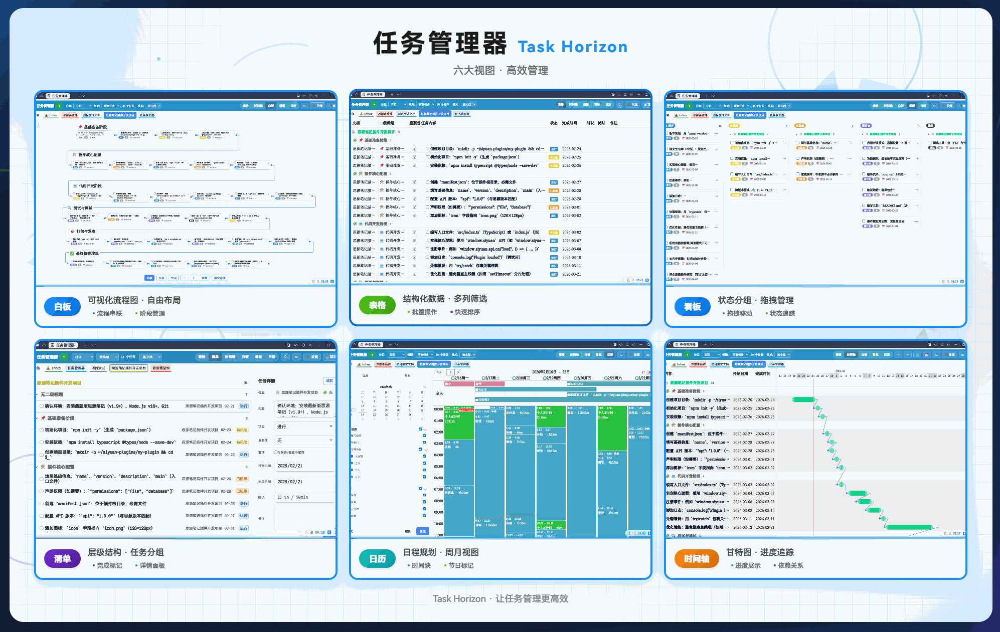

[简体中文](README.zh-CN.md)

# Task Horizon

Task Horizon is a task workspace for [SiYuan](https://github.com/siyuan-note/siyuan). Collect tasks from your documents and work with them in checklist, table, timeline, Kanban, calendar, and whiteboard views. A homepage brings together project progress, recent completions, and focus statistics.

The same plugin includes English and Simplified Chinese. Existing installations keep their settings, task data, and activation state.

## What's new in 3.3.6

- **English interface:** switch between English, Simplified Chinese, or the SiYuan interface language in Appearance settings.
- **Task handling:** completed parents can be reopened with their subtasks reset; dated subtasks no longer send parent tasks to the unscheduled group, and creating a subtask keeps its details view on the right task.
- **Mobile and calendar:** reserve space above the mobile view switcher for expanded subtasks; refine calendar time-axis labels and all-day collapse controls.

## Install or update

Requires SiYuan 3.8.4 or later.

- **Marketplace:** open SiYuan's Settings → Marketplace → Plugins, search for **Task Horizon** (任务管理器), install it, and enable it under downloaded plugins.
- **Manual installation:** download `package.zip` from the [latest release](https://github.com/5kyfkr/siyuan-plugin-task-horizon/releases/latest), extract it into `{workspace}/data/plugins/siyuan-plugin-task-horizon/`, then restart SiYuan and enable the plugin.

For updates, use the marketplace or replace the plugin files with the new release. Keep the plugin folder name `siyuan-plugin-task-horizon`.

The separate community English fork has a different plugin storage folder. Back up your workspace before transferring its settings to this official plugin.

## Choose your language

Open Task Horizon's **Settings → Appearance → Font size & density → Interface language** and choose:

- **Follow SiYuan:** use the SiYuan interface language; unsupported languages fall back to English.
- **简体中文:** always use Simplified Chinese.
- **English:** always use English.

The preference is saved with plugin settings and follows SiYuan synchronization across devices. With Follow SiYuan selected, each device uses its own SiYuan language. Click **Reload interface** after saving to apply a change.

Task titles, notes, document names, and custom status, group, and field names keep their original text. Interface language does not change stored dates, time zones, or task markers.

## Get started

1. Open Task Horizon from its top bar button, command, or task dock.
2. In **Settings → Tasks**, add the documents or notebooks you want to collect. Include child documents when needed.
3. Choose a document group and a view. New installations include recommended filters such as Incomplete, Today, Overdue, Next seven days, and Unscheduled.
4. Create a task with quick add or use existing SiYuan task list items. Configure a default destination document for faster capture.
5. Edit a task in its details panel or enable the quickbar to edit fields directly in SiYuan documents.

If the workspace is empty, check the selected document group and its source documents, then check the active filter. Updates preserve existing custom filters.

See the [full Chinese usage guide](https://ld246.com/article/1793325419094).

## Views and navigation

| View | Use it for |
| --- | --- |
| Homepage | Project progress, overview, completion trends, heatmap, and focus statistics |
| Checklist | Daily work with nested tasks, notes, and compact task fields |
| Table | Compare and edit tasks using configurable columns |
| Timeline | Task date ranges and dependencies |
| Kanban | Group tasks into columns and move tasks between them |
| Calendar | Tasks, schedules, reminders, and supported focus records |
| Whiteboard | Arrange task cards, notes, frames, drawings, and connections |

Document tabs, document groups, shortcuts, and filters control the scope. Search, grouping, and sorting help narrow larger collections. The task dock and mobile fullscreen entry provide additional ways to open the workspace.

## Tasks, fields, and editing

- Edit importance, status, start and due dates, time, estimated duration, notes, attachments, and supported custom fields.
- Add subtasks, move tasks, pin important tasks, and batch-edit supported fields.
- Customize columns, card fields, document colors, and desktop and mobile presentation settings.
- Combine filter conditions and sorting. Importance and the configurable priority score are separate fields.
- Configure completion, archive, recycle, and delete behavior. These actions may update the underlying SiYuan document.

Default native task markers are `[ ]` for to-do, `[/]` for in progress, `[X]` for done, and `[-]` for abandoned tasks on supported hosts. Customize status names and colors in task settings. Compatibility modes may use a reduced marker set.

## Repeats, review, and reminders

Configure repeating tasks from task details or the date controls. Modes include scheduled repeats, repeats calculated after completion, check-ins, and spaced review where supported.

Check-in tasks record completion for individual dates. To permanently finish one, turn repeating off or switch its repeat mode. Review tasks support Again, Hard, Good, and Easy ratings.

Calendar schedules and task reminders have separate settings. Native notifications depend on the SiYuan client and its notification permissions.

Automatic date recognition includes Chinese phrases such as `明天` and `下周五`, along with supported numeric date/time formats. Selecting English does not add a complete English natural-language date parser. Use the date picker for unambiguous scheduling.

## Calendar and integrations

The calendar supports day, week, month, and list presentations, task editing, schedules, and an optional sidebar. Configure working days, holidays, display options, and reminders in time settings.

Optional integrations include Dock Tomato for focus and Pomodoro statistics, supported points plugins, and calendar ICS publication. Enable the integrations you use and configure their data sources and permissions.

ICS publication can send task or schedule titles and times to an external destination. Review the selected scope and destination before enabling it.

## AI assistant

Task Horizon provides a SiYuan Agent workbench and a legacy AI mode. Configure the mode and provider in AI settings. Available functionality depends on the SiYuan version, provider, permissions, and plugin license.

The workbench can use tasks, documents, and the current view as context. Built-in workflows help capture tasks, plan schedules, review progress, and prepare templates. Scheduling rules describe default durations, available time, blocked periods, and document or group overrides.

Review proposed writes and tool permissions before applying changes. Scheduled AI events have separate execution and output settings. Your conversations, prompts, presets, and edited skills remain user content and are preserved when changing language.

## Settings and data

Settings cover tasks, views, time, appearance, AI, rules, data, and licensing. Use settings search to find individual controls.

Task content remains in SiYuan documents. Plugin settings and metadata are stored under `data/storage/petal/siyuan-plugin-task-horizon/` in the workspace, with local caches for supported features. SiYuan handles workspace synchronization.

Back up your workspace before a large import, storage migration, or archive/delete configuration change. Data settings include supported import, export, and settings backup options, including TickTick CSV import and spreadsheet export.

## Licensing and support

Some advanced features require activation. Open the licensing page in plugin settings for current features, plans, payment instructions, and activation controls. Both interface languages use the same plugin identity and activation.

- [Report a bug or request a feature](https://github.com/5kyfkr/siyuan-plugin-task-horizon/issues)
- [Releases and update notes](https://github.com/5kyfkr/siyuan-plugin-task-horizon/releases)
- [Full change history](https://github.com/5kyfkr/siyuan-plugin-task-horizon/blob/main/CHANGELOG.md)
- QQ community: **758666272** ([join](https://qm.qq.com/q/MRkXe3Z00U)); discussion is primarily in Chinese.

Include the plugin and SiYuan versions, client type, reproduction steps, and relevant screenshots when reporting a problem. Remove private task content and credentials.

## FAQ

**Why are there no tasks?** Add source documents or notebooks to the current group. Check the active filter and completed-task visibility.

**Why are some names still Chinese?** Names stored in documents or custom settings are preserved. Renaming user content is independent of the interface language.

**Why did another device keep the previous language?** Let SiYuan synchronize plugin settings, then reload its interface. With Follow SiYuan selected, check that device's SiYuan language.

**Do I need to reinstall or reactivate for English?** Both languages use the same package, storage, and activation. Change the language in settings.

## Contributing

Translations live in `i18n/en.json` and `i18n/zh-CN.json`. Use stable semantic keys and named parameters. See the [translation guide](https://github.com/5kyfkr/siyuan-plugin-task-horizon/blob/main/docs/i18n.md) and [test instructions](https://github.com/5kyfkr/siyuan-plugin-task-horizon/blob/main/scripts/README.md).

Changes to user workflows should update both README files in the same change. Fixes that do not alter usage only need a note in `CHANGELOG.md`.

## Credits

Task Horizon is created by **5kyfkr**. Thanks to the contributors and sponsors, including **bytemain** and **ProgramFan**. Initial English wording draws on [5pyd3r1's community English fork](https://github.com/5pyd3r1/siyuan-plugin-task-horizon-en), under the project's MIT license.

Dependencies include SiYuan, FullCalendar, Basecoat UI, and SheetJS. See their respective licenses and source credits.

For funding information, see the repository or plugin settings. The [Chinese README](README.zh-CN.md) retains all existing acknowledgements, sponsors, donation information, and historical release notes.
