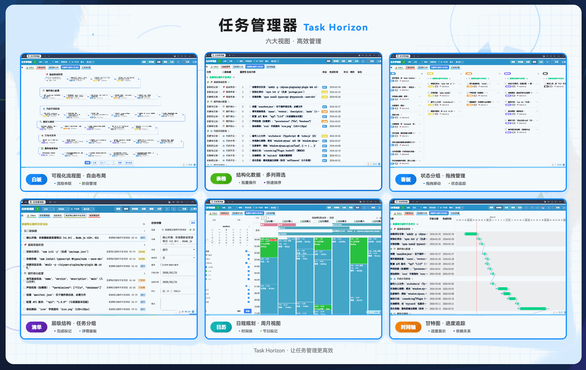

[简体中文](README.zh-CN.md)

# Task Horizon

Task Horizon is a task workspace for [SiYuan](https://github.com/siyuan-note/siyuan). Collect tasks from your documents and work with them in checklist, table, timeline, Kanban, calendar, and whiteboard views. A homepage brings together project progress, recent completions, and focus statistics.

The same plugin includes English and Simplified Chinese. Existing installations keep their settings, task data, and activation state.

## What's new in 3.4.0

- **Calendar and sync:** add one-way CalDAV upload to NAS or iCloud calendars, with calendar discovery, target selection, and manual or automatic upload from this device. CalDAV shares ICS scope and content settings and works with ICS upload turned off. The top bar's **Upload calendar now** button uploads through all enabled channels.
- **Quadrant groups and Kanban:** drag tasks between quadrants in checklist, table, and Kanban views to update importance and due date together according to the target rules. Empty quadrants remain available as drop targets, with consistent date matching and updated counts. Check-in tasks and conflicting rules show a prompt.
- **Quick add:** pin a task before creating it. Configure the pin button in display field settings; on mobile it starts in **More**. Refine toolbar and picker hover feedback and prevent highlights from sticking after touch input.
- **Whiteboard sequence mode:** linked subtasks now reveal later steps in order without detaching them from the parent card. Independent chains advance separately; fix blocked steps under unfinished parents and hidden subtasks reappearing in Kanban.

Previous releases

## What's new in 3.3.9

- **Calendar schedules:** when adding a schedule from a task in the Dock sidebar, the editor stays over the current task details instead of jumping to the left of the main view. Changing the start time preserves the original duration and moves the end time with it, avoiding invalid start/end boundaries.
- **View recovery and Kanban:** validate the current navigation context before restoring UI from an older snapshot, preventing stale document, view, detail, or homepage state from replacing newer navigation. After a field edit moves a task to an off-screen Kanban column, scrolling to that column now loads its card instead of leaving a blank column.
- **Summary:** bounded date filters now use the due date for unfinished tasks and the completion date for completed tasks. Due and completion dates are independent summary fields, and date grouping uses the applicable task date.

## What's new in 3.3.8

- **Mobile task details:** scroll a long status picker directly without first expanding the detail sheet. The first tap now opens the Copy submenu in the task More menu, while mouse hover remains supported.
- **Calendar schedules and ICS:** when creating a schedule from a task in the Dock sidebar, the editor stays over the current task details instead of jumping to the left of the main view. Changing a schedule's start time now preserves its original duration and moves the end time with it, avoiding invalid start/end boundaries. Task-manager and ICS-upload topbar entries use stable identities to prevent icon placeholder and visibility problems, and WebDAV, S3, and sync-scope fields use a clearer stacked layout on narrow screens.
- **Sync:** schedule task-index and snapshot cache refreshes after a successful synchronized data refresh instead of running an independent refresh pipeline, reducing duplicate work while retaining pending work when the view is hidden or not ready.

## What's new in 3.3.7

- **Task templates:** create reusable parent-child structures from **More → Task templates** in quick add, with starter templates for feature releases, articles, and weekly planning. Manage, copy, reorder, and edit templates; select branches and replace `{{主题}}` with the current topic. Tasks are created in the background, and retrying after an interruption continues only the remaining tasks.
- **Calendar and ICS subscriptions:** publish ICS feeds to S3-compatible storage, including MinIO and R2, with manual settings or this device's SiYuan S3 configuration. The subscription URL is generated automatically, supports direct or proxied access, and is verified after upload. LianDi, WebDAV, and S3 now share the fixed `task-horizon.ics` filename; existing randomly named feeds need the new URL. Sync scope is now a separate calendar settings section with clearer WebDAV and S3 guidance.
- **Settings sync:** improve reloading of synchronized task-count badge, search scope, per-document heading, whiteboard navigator, and task-template settings.
- **Fixes:** text undo and redo no longer trigger a completion prompt or check-in update when the checkbox is unchanged, and related shortcuts resolve only the task at the caret. Uninstalling also removes the derived document-scope cache while preserving tasks and settings.

## What's new in 3.3.6

- **English interface:** switch between English, Simplified Chinese, or the SiYuan interface language in Appearance settings.
- **Task handling:** completed parents can be reopened with their subtasks reset; dated subtasks no longer send parent tasks to the unscheduled group, and creating a subtask keeps its details view on the right task.
- **Mobile and calendar:** reserve space above the mobile view switcher for expanded subtasks; refine calendar time-axis labels and all-day collapse controls.

## Install or update

Requires SiYuan 3.8.4 or later.

- **Marketplace:** open SiYuan's Settings → Marketplace → Plugins, search for **Task Horizon** (任务管理器), install it, and enable it under downloaded plugins.
- **Manual installation:** download `package.zip` from the [latest release](https://github.com/5kyfkr/siyuan-plugin-task-horizon/releases/latest), extract it into `{workspace}/data/plugins/siyuan-plugin-task-horizon/`, then restart SiYuan and enable the plugin.

For updates, use the marketplace or replace the plugin files with the new release. Keep the plugin folder name `siyuan-plugin-task-horizon`.

The separate community English fork has a different plugin storage folder. Back up your workspace before transferring its settings to this official plugin.

## Choose your language

Open Task Horizon's **Settings → Appearance → Font size & density → Interface language** and choose:

- **Follow SiYuan:** use the SiYuan interface language; unsupported languages fall back to English.
- **简体中文:** always use Simplified Chinese.
- **English:** always use English.

The preference is saved with plugin settings and follows SiYuan synchronization across devices. With Follow SiYuan selected, each device uses its own SiYuan language. Click **Reload interface** after saving to apply a change.

Task titles, notes, document names, and custom status, group, and field names keep their original text. Interface language does not change stored dates, time zones, or task markers.

## Get started

1. Open Task Horizon from its top bar button, command, or task dock.
2. In **Settings → Tasks**, add the documents or notebooks you want to collect. Include child documents when needed.
3. Choose a document group and a view. New installations include recommended filters such as Incomplete, Today, Overdue, Next seven days, and Unscheduled.
4. Create a task with quick add or use existing SiYuan task list items. Configure a default destination document for faster capture.
5. Edit a task in its details panel or enable the quickbar to edit fields directly in SiYuan documents.

If the workspace is empty, check the selected document group and its source documents, then check the active filter. Updates preserve existing custom filters.

See the [full Chinese usage guide](https://ld246.com/article/1793325419094).

## Views and navigation

| View | Use it for |
| --- | --- |
| Homepage | Project progress, overview, completion trends, heatmap, and focus statistics |
| Checklist | Daily work with nested tasks, notes, and compact task fields |
| Table | Compare and edit tasks using configurable columns |
| Timeline | Task date ranges and dependencies |
| Kanban | Group tasks into columns and move tasks between them |
| Calendar | Tasks, schedules, reminders, and supported focus records |
| Whiteboard | Arrange task cards, notes, frames, drawings, and connections |

Document tabs, document groups, shortcuts, and filters control the scope. Search, grouping, and sorting help narrow larger collections. The task dock and mobile fullscreen entry provide additional ways to open the workspace.

## Tasks, fields, and editing

- Edit importance, status, start and due dates, time, estimated duration, notes, attachments, and supported custom fields.
- Add subtasks, move tasks, pin important tasks, and batch-edit supported fields.
- Create reusable parent-child structures from **More → Task templates**. Choose a template from its submenu, select branches, and replace `{{主题}}` with this creation's topic. The template toolbar shows only the existing document-location control. Manage templates from the submenu in plain entry mode. Submitting closes quick-add and continues task creation in the background; the next quick-add opens in plain entry mode.
- Customize columns, card fields, document colors, and desktop and mobile presentation settings.
- Combine filter conditions and sorting. Importance and the configurable priority score are separate fields.
- Configure completion, archive, recycle, and delete behavior. These actions may update the underlying SiYuan document.

Default native task markers are `[ ]` for to-do, `[/]` for in progress, `[X]` for done, and `[-]` for abandoned tasks on supported hosts. Customize status names and colors in task settings. Compatibility modes may use a reduced marker set.

## Repeats, review, and reminders

Configure repeating tasks from task details or the date controls. Modes include scheduled repeats, repeats calculated after completion, check-ins, and spaced review where supported.

Check-in tasks record completion for individual dates. To permanently finish one, turn repeating off or switch its repeat mode. Review tasks support Again, Hard, Good, and Easy ratings.

Calendar schedules and task reminders have separate settings. Native notifications depend on the SiYuan client and its notification permissions.

Automatic date recognition includes Chinese phrases such as `明天` and `下周五`, along with supported numeric date/time formats. Selecting English does not add a complete English natural-language date parser. Use the date picker for unambiguous scheduling.

## Calendar and integrations

In **Time → CalDAV upload**, enter your NAS or iCloud CalDAV server URL and credentials, discover calendars, select a target, and upload manually or enable automatic upload on this device. Scope and content settings are shared with ICS upload, which can remain off. Upload is one-way: external edits are not imported into Task Horizon.

ICS subscriptions can publish to LianDi, WebDAV, or S3-compatible storage including MinIO and R2. In **Time → ICS upload**, choose **S3 / MinIO / R2**, enter the API endpoint, region, bucket and credentials, then click **Update now**. You can also reference this device's SiYuan S3 settings. Every provider uses `task-horizon.ics`, with no random suffix or filename setting. The plugin generates the subscription URL from the destination settings; copy it after a successful upload. Later publications overwrite the same file and verify its contents. Changing the bucket, directory or public domain changes the URL and requires subscribing again. Existing subscriptions using a randomly named file must switch to the new URL after uploading.

For local MinIO, enable **Path Style** and use **Auto** or **Direct**. Configure MinIO CORS to allow `GET` and `PUT` with the `Content-Type` and `Cache-Control` headers from your SiYuan origin. The subscription file must allow anonymous reads and be reachable by your calendar app. R2 needs a public bucket URL or custom domain in **Public access URL**. Credentials synchronize with plugin settings and are excluded from manual exports. Calendar name and content options are grouped under **Sync scope**.

For a manual S3 configuration, enter the endpoint, region, bucket name and matching access key pair. The storage directory is optional, and Path Style and connection method usually keep their defaults. Reusing SiYuan's S3 settings hides the inherited fields.

| Service | Endpoint example | Region | Public access URL |
| --- | --- | --- | --- |
| Amazon S3 | `https://s3.us-east-1.amazonaws.com` | The bucket's region, such as `us-east-1` | Leave empty for automatic generation, or use your bucket's public base URL |
| MinIO | `http://192.168.1.10:9000` (API address) | Usually `us-east-1`; use the administrator's setting | Optional; for example `https://files.example.com/calendar/` for a bucket named `calendar` |
| Cloudflare R2 | `https://ACCOUNT_ID.r2.cloudflarestorage.com` | `auto` | Required: a public bucket URL or a domain bound to the bucket, such as `https://calendar.example.com/` |

Public access URLs identify the bucket root. The plugin appends the storage directory and fixed filename. See [R2 endpoint and region settings](https://developers.cloudflare.com/r2/api/s3/api/) and [R2 public access](https://developers.cloudflare.com/r2/buckets/public-buckets/).

WebDAV has three fields: a directory URL, username and password. For Nutstore, create a `task-ics` folder, enter `https://dav.jianguoyun.com/dav/task-ics/`, use your account email, and generate an app password under **Account information → Security options → Third-party app management**. The plugin writes `task-horizon.ics`; omit the filename. [Nutstore app password instructions](https://help.jianguoyun.com/?p=2064)

The displayed WebDAV URL excludes credentials. A calendar supporting HTTP authentication needs the account and app password entered separately. Other calendars need a URL that directly returns the ICS file; a share page alone is insufficient. WebDAV requests run on the SiYuan server, whose proxy may reject local NAS addresses, so confirm the service is reachable from that server. Public WebDAV URLs must use HTTPS.

The calendar supports day, week, month, and list presentations, task editing, schedules, and an optional sidebar. Configure working days, holidays, display options, and reminders in time settings.

Optional integrations include Dock Tomato for focus and Pomodoro statistics, supported points plugins, and calendar ICS publication. Enable the integrations you use and configure their data sources and permissions.

ICS publication can send task or schedule titles and times to an external destination. Review the selected scope and destination before enabling it.

## AI assistant

Task Horizon provides a SiYuan Agent workbench and a legacy AI mode. Configure the mode and provider in AI settings. Available functionality depends on the SiYuan version, provider, permissions, and plugin license.

The workbench can use tasks, documents, and the current view as context. Built-in workflows help capture tasks, plan schedules, review progress, and prepare templates. Scheduling rules describe default durations, available time, blocked periods, and document or group overrides.

Review proposed writes and tool permissions before applying changes. Scheduled AI events have separate execution and output settings. Your conversations, prompts, presets, and edited skills remain user content and are preserved when changing language.

## Settings and data

Settings cover tasks, views, time, appearance, AI, rules, data, and licensing. Use settings search to find individual controls.

Task content remains in SiYuan documents. Plugin settings and metadata are stored under `data/storage/petal/siyuan-plugin-task-horizon/` in the workspace, with local caches for supported features. SiYuan handles workspace synchronization.

Back up your workspace before a large import, storage migration, or archive/delete configuration change. Data settings include supported import, export, and settings backup options, including TickTick CSV import and spreadsheet export.

## Licensing and support

Some advanced features require activation. Open the licensing page in plugin settings for current features, plans, payment instructions, and activation controls. Both interface languages use the same plugin identity and activation.

- [Report a bug or request a feature](https://github.com/5kyfkr/siyuan-plugin-task-horizon/issues)
- [Releases and update notes](https://github.com/5kyfkr/siyuan-plugin-task-horizon/releases)
- [Full change history](https://github.com/5kyfkr/siyuan-plugin-task-horizon/blob/main/CHANGELOG.md)
- QQ community: **758666272** ([join](https://qm.qq.com/q/MRkXe3Z00U)); discussion is primarily in Chinese.

Include the plugin and SiYuan versions, client type, reproduction steps, and relevant screenshots when reporting a problem. Remove private task content and credentials.

## FAQ

**Why are there no tasks?** Add source documents or notebooks to the current group. Check the active filter and completed-task visibility.

**Why are some names still Chinese?** Names stored in documents or custom settings are preserved. Renaming user content is independent of the interface language.

**Why did another device keep the previous language?** Let SiYuan synchronize plugin settings, then reload its interface. With Follow SiYuan selected, check that device's SiYuan language.

**Do I need to reinstall or reactivate for English?** Both languages use the same package, storage, and activation. Change the language in settings.

## Contributing

Translations live in `i18n/en.json` and `i18n/zh-CN.json`. Use stable semantic keys and named parameters. See the [translation guide](https://github.com/5kyfkr/siyuan-plugin-task-horizon/blob/main/docs/i18n.md) and [test instructions](https://github.com/5kyfkr/siyuan-plugin-task-horizon/blob/main/scripts/README.md).

Changes to user workflows should update both README files in the same change. Fixes that do not alter usage only need a note in `CHANGELOG.md`.

## Credits

Task Horizon is created by **5kyfkr**. Thanks to the contributors and sponsors, including **bytemain** and **ProgramFan**. Initial English wording draws on [5pyd3r1's community English fork](https://github.com/5pyd3r1/siyuan-plugin-task-horizon-en), under the project's MIT license.

Dependencies include SiYuan, FullCalendar, Basecoat UI, and SheetJS. See their respective licenses and source credits.

For funding information, see the repository or plugin settings. The [Chinese README](README.zh-CN.md) retains all existing acknowledgements, sponsors, donation information, and historical release notes.
